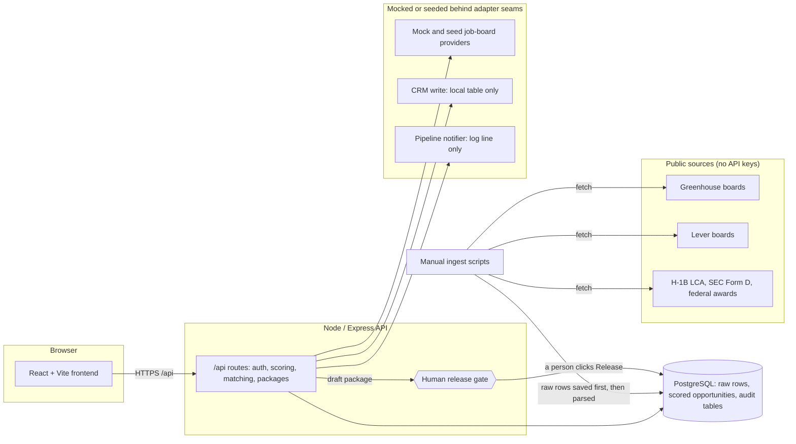

# TalentSignal

**A staffing-intelligence web app that finds hiring demand hiding in public job postings, explains every score in plain language, and never lets the software send anything without a person releasing it.**

> Status: a local-only portfolio and case-study project. There is no hosted demo. See [Status](#status).

## The problem

Staffing teams usually learn about a hard-to-fill role late: after a competitor has already
placed someone, or after the client has gone quiet. The early signals are public but scattered
across job boards: a posting that has been open for months, a role that keeps being reposted, a
listing with no salary range, an employer whose public filings show they are hiring. Nobody has
time to read thousands of postings and weigh those clues.

TalentSignal pulls those clues together, ranks which roles look worth a closer look, shows how
well the available candidates fit, and drafts the outreach, **but a human stays in charge of
every decision that leaves the system.** It is a decision aid, not an autopilot.

## What it does

- **Reads public hiring data.** Greenhouse and Lever job boards (public, no API key), plus public
  employer hiring records (H-1B LCA disclosures, SEC Form D filings, federal awards) as extra
  evidence.
- **Scores with transparent rules, not a black box.** Each posting gets a demand-evidence score and,
  where it applies, a hard-to-fill signal. Every score shows its reasons and the weights version
  that produced it.
- **Explains itself in plain language.** Each opportunity card opens with a one-sentence verdict, a
  stacked bar showing which clues moved the score, and a collapsed "Show the math" section with the
  raw numbers.
- **Matches candidates to roles** by skill overlap (a simple rule, not a prediction).
- **Drafts a client-facing package and email** from templates. A person reviews, edits and clicks
  Release. In this project releasing records the decision; nothing is actually sent.
- **Teaches itself to new users** with a guided tour that navigates the real app and spotlights each
  section.

Screenshot placeholders (to be added in [`docs/screenshots/`](docs/screenshots/README.md)):

> 📷 **Login:** `docs/screenshots/login.png`
>
> 📷 **Overview:** `docs/screenshots/overview.png`
>
> 📷 **Opportunities card:** `docs/screenshots/opportunities-card.png`
>
> 📷 **Signals:** `docs/screenshots/signals.png`
>
> 📷 **Guided tour:** `docs/screenshots/guided-tour.png`

## How it works



- **Frontend:** React 18 + TypeScript + Vite ([`frontend/`](frontend/)).
- **API:** Node + Express + TypeScript ([`backend/`](backend/)), routes under `/api/*`, JWT auth with
  three roles (admin, sales, recruiter).
- **Database:** PostgreSQL. SQL migrations run on boot ([`backend/src/db/migrations/`](backend/src/db/migrations/)).
- **Ingestion:** manual scripts (`npm run ingest:once`, `npm run ingest:capacity-once`). Nothing polls
  on a schedule.
- **Adapter seams:** every external provider sits behind an interface
  ([`backend/src/adapters/`](backend/src/adapters/)) so a real one can replace a mock without touching
  the routes or the scoring.

## The rules it is built under

These are enforced in code and tests, not just written down.

1. **Human release.** The software drafts and suggests; a person reviews and releases anything that
   would leave the platform or write to a client record. Release is a guarded, once-only database
   update with an audit row ([`backend/src/routes/opportunityPackage.ts`](backend/src/routes/opportunityPackage.ts)).
2. **Live / seeded / stubbed labels.** The screen always says what kind of data it is showing:
   a source is "live", "fixture" or "flagged, excluded"; demo candidates are labelled; placeholders
   (resume parsing, response-rate tracking) say they are placeholders.
3. **Raw-persist-before-parse.** Every fetched posting is written verbatim to `raw_requisitions`
   before any parsing touches it, so nothing is lost if the parser is wrong
   ([decision 041](06_decisions/041-raw-and-parsed-requisitions-schema.md)).
4. **Version-stamped weights.** Every stored score records which weights produced it, such as
   `confidence-007-v1` or `hard-to-fill-026-v3`, so an old score stays traceable after the weights
   change ([decision 012](06_decisions/012-confidence-weight-versioning.md)).
5. **Null results are valid.** "Not enough data" is an acceptable answer. The validation study
   below reports *insufficient data* instead of forcing a conclusion, and empty screens say
   "No data yet" instead of showing a zero that looks like a finding.

Plus: heuristic first (no machine learning), no secrets in the repo, an explicit timeout on every
outbound call, and structured JSON logs with a correlation id. The full list is in
[`CLAUDE.md`](CLAUDE.md); each business-logic choice has its own entry in
[`06_decisions/`](06_decisions/).

## Honest findings

- **The hard-to-fill score could not be validated yet.** The S-25 study asked whether a high score
  predicts a longer time-to-fill. The high-score group had **4** requisitions against a declared
  minimum of **20**, so the answer is *insufficient data*, not "it works" and not "it fails". No
  weights were changed. Full write-up:
  [`07_analyses/s25-hardness-validation-2026-10-06.md`](07_analyses/s25-hardness-validation-2026-10-06.md).
- **A visual redesign quietly removed provenance, and the tests caught it.** After a restyle, 17
  frontend tests failed. Eleven of them were not wording changes: the opportunity card had stopped
  showing its factor breakdown, its weights version and its "how this was scored" facts. The fix was
  to restore that content (now behind "Show the math"), not to loosen the tests.
- **The same count appeared two different ways.** A number audit found "measured basis" shown as 180
  on three screens and 155 on the opportunity cards, because some screens re-derived it in the
  browser. All screens now show the stored value, and the finding is logged as a PROPOSED decision
  ([decision 051](06_decisions/051-none-basis-fallthrough.md)). The audit itself:
  [`07_analyses/number-audit-2026-11-03.md`](07_analyses/number-audit-2026-11-03.md).
- **Known open issues, not fixed.** When many postings tie for the top score, the "top pick" can land
  on a row from a source the app itself marks "flagged, excluded". Flagged-source rows also still carry
  the hard-to-fill badge. Both touch ranking, which is a business decision, so they are written down
  here instead of silently changed.

## Status

- **Local only.** There is no hosted demo and no public URL. Older decision records
  ([`06_decisions/`](06_decisions/), for example 034, 036, 037, 038 and 042) describe an earlier hosted
  deployment; treat those as project history.
- **Tests (as of 2026-11-03):** frontend 114 tests, backend 468 tests when run against a real
  Postgres (unit tests alone run without a database; integration tests skip themselves). CI runs on
  every push ([`.github/workflows/ci.yml`](.github/workflows/ci.yml)).
- **Data is demo data.** Candidate profiles are fixtures. Placement history and package examples are
  seeded. Resume upload is a preview: files are not parsed.
- **Nothing is sent.** Releasing a package records a decision. There is no email integration.

## Run it locally

**Prerequisites:** Git, Node.js 20, Docker Desktop.

```bash
git clone https://github.com/ang3lmbenoun/talentsignal.git
cd talentsignal
cp .env.example .env        # then edit the values below
```

In `.env`, set at least:

- `JWT_SECRET`, a long random value. Generate one with `openssl rand -base64 32`. The backend
  refuses to start without it.
- `ADMIN_EMAIL` and `ADMIN_BOOTSTRAP_PASSWORD`, only if you want a bootstrap admin account.
- The database settings already have local defaults. See the comments in [`.env.example`](.env.example).

Never commit `.env` (it is git-ignored). Then:

```bash
docker compose up -d --build        # database, API (runs migrations on boot), frontend
cd backend && npm ci
DATABASE_URL="postgres://<user>:<password>@localhost:5433/<db>" npm run seed:demo   # optional demo data
```

- Frontend: <http://localhost:5173>
- API: <http://localhost:4000> (health check at `/api/health`)
- Postgres: `localhost:5433` (host port; the container uses 5432)

To pull real public postings instead of the demo data, set `GREENHOUSE_BOARDS` and
`LEVER_COMPANIES` in `.env` and run `npm run ingest:once` from `backend/` (with the same
`DATABASE_URL`).

**Tests**

```bash
cd backend && npm test        # unit tests; integration/E2E skip without DATABASE_URL
cd frontend && npm test
```

Set `DATABASE_URL` to a real, migrated Postgres to run the integration and end-to-end suites too.

## Repo map

```
README.md              This case study
ONBOARDING.md          One-page orientation for a new builder
CLAUDE.md              The operating rules the build follows (human release, decision logging, definition of done)
GAME_PLAN.md           Early planning notes
00_scope/              The captured spec and per-story acceptance criteria (Gherkin)
06_decisions/          One entry per business-logic choice: what it rests on, what would make it wrong
07_analyses/           Validation and audit write-ups (S-25 study, number audit)
07_meeting_notes/      Working notes from project check-ins
05_presentations/      Per-story build summaries and demo evidence
docs/screenshots/      Where the README's five screenshots go (not captured yet)
frontend/              React + Vite app
backend/               Express API
  src/adapters/          Provider seams: public sources and mocks
  src/scoring/           Transparent scoring rules and versioned weights
  src/db/migrations/     SQL migrations, run on boot
  tests/                 Unit, integration and end-to-end tests
Dockerfile             Top-level multi-stage image (frontend + API)
docker-compose.yml     Local development stack
.env.example           Template for the local .env (blank secrets)
.github/workflows/     CI
BusinessAnalysis_FieldGuide.html   Standalone business-analyst field guide (self-contained HTML)
talentsignal-dashboard.html        UI mockups the redesign was matched against
talentsignal-redesign.html
login.json, nouser.json,           Old hand-made request bodies for trying the login/register
reg.json, wrongpw.json             endpoints with curl (throwaway demo accounts, S-02). No test or
                                   script uses them; decision 030 notes them as a leftover to remove.
```

## What's next

- **An LLM explainer is a PROPOSED idea, not built.** Today no language model is called anywhere in
  the code: verdict sentences, package drafts and email drafts are all deterministic templates. A
  future explainer could rewrite the existing, already-computed facts in friendlier language. It would
  be added behind the same adapter seam and the same human-release rule, and it would need its own
  decision-log entry before any code.
- Decide the two ranking issues above (flagged sources and the top pick).
- Rescore the 28 postings still on the oldest weights so stored and derived values agree
  ([decision 051](06_decisions/051-none-basis-fallthrough.md)).
- Re-run the S-25 validation as more requisitions accumulate and close.
- Real resume parsing and a client-creation screen (both deferred).
